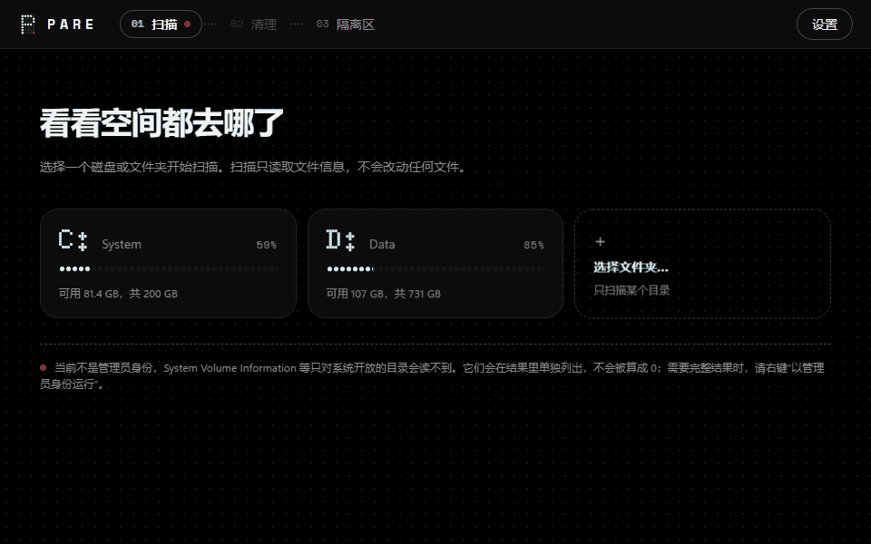
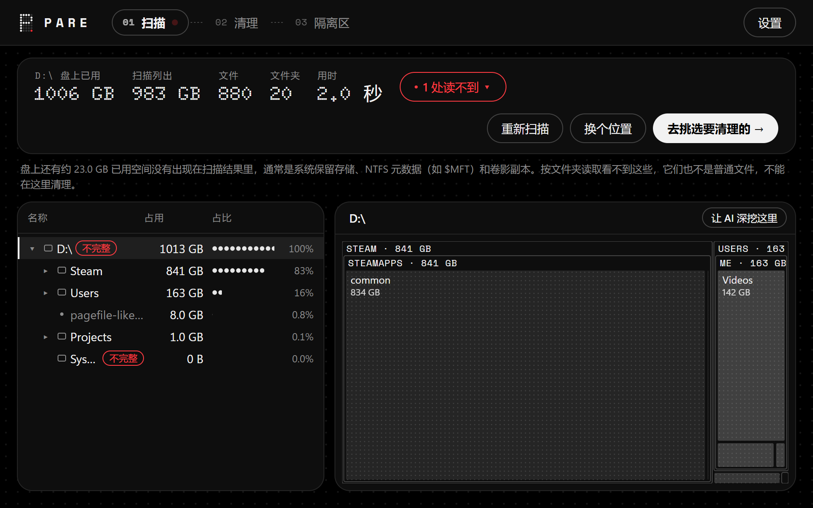
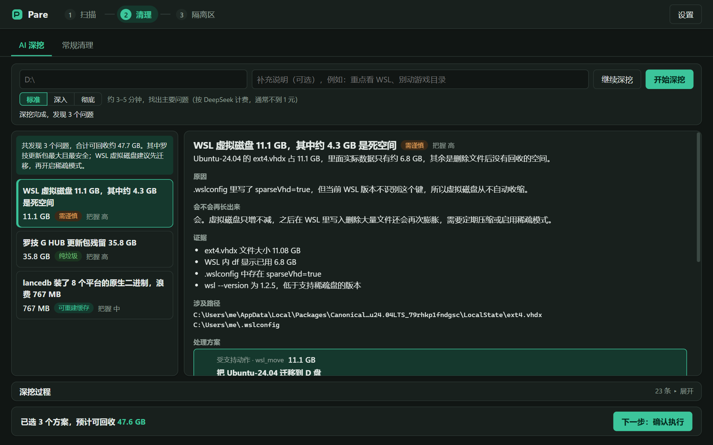
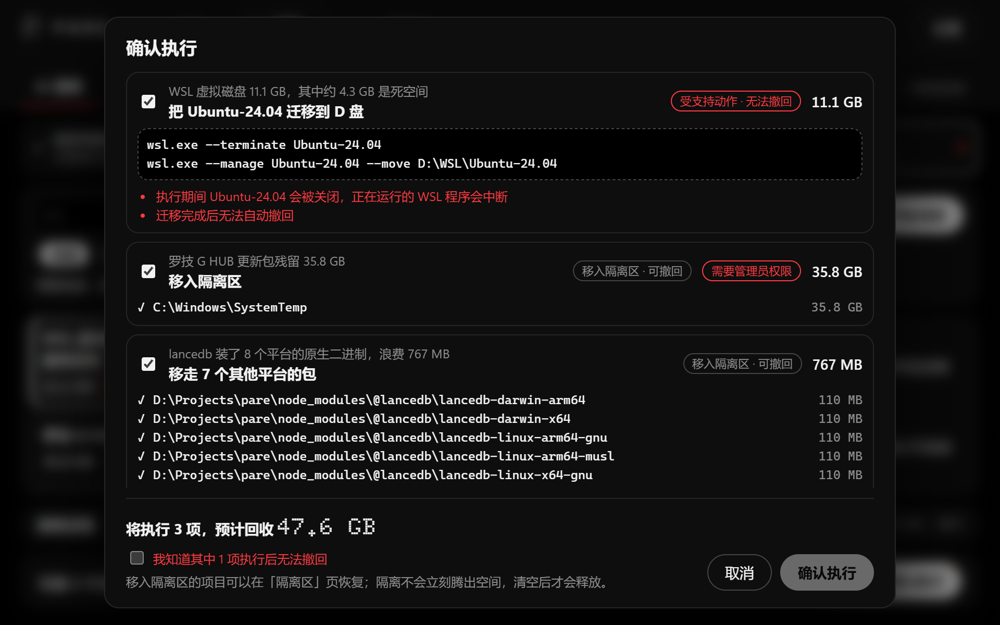
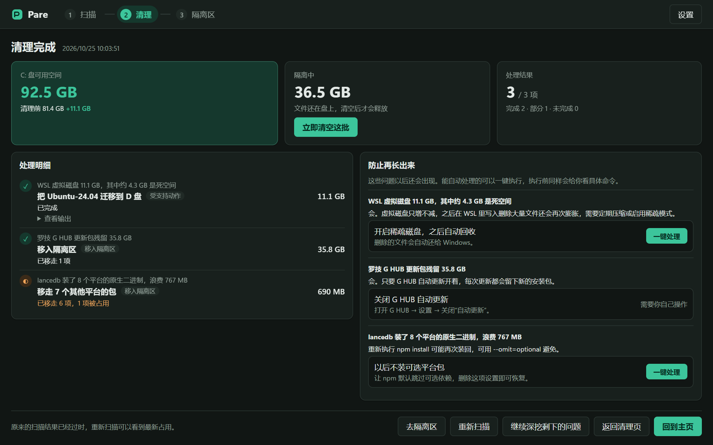

<p align="center">
  
</p>

<p align="center">
  <a href="README.md">English</a> · <a href="README.zh-CN.md">简体中文</a> · <a href="README.zh-TW.md">繁體中文</a> · <a href="README.ja.md">日本語</a> · <b>Français</b> · <a href="README.de.md">Deutsch</a>
</p>

<p align="center">
  
  
  
  
  
</p>

<p align="center">
  <a href="https://github.com/DRAG0NM/Pare/releases/download/v0.2.1/Pare-0.2.1-win-x64.zip"></a>
</p>
<p align="center"><sub>Archive zip portable · 5 Mo · sans installateur · <a href="https://github.com/DRAG0NM/Pare/releases/tag/v0.2.1">notes de version et sommes de contrôle</a></sub></p>

Les logiciels de nettoyage du commerce vident les caches que tout le monde possède. L'espace qui disparaît réellement est le plus souvent propre à une seule machine : un programme de mise à jour qui télécharge sans fin le même installateur de 300 Mo, un disque WSL qui grossit sans jamais rétrécir, un paramètre écrit dans la mauvaise section et ignoré en silence, des binaires natifs pour des plateformes que ce PC n'exécutera jamais.

**Pare envoie un enquêteur IA traquer ce genre de gaspillage.** Il lit l'analyse, ouvre les fichiers dont il a besoin, recoupe les programmes installés et l'état du système, puis explique chaque problème : de quoi il s'agit, pourquoi il est apparu, s'il reviendra, et ce que vous pouvez faire. Rien ne change sur le disque tant que vous n'avez pas vu les éléments ou les commandes exacts et que vous ne les avez pas confirmés ; les nettoyages de fichiers vont dans une quarantaine que vous pouvez annuler.

<p align="center">
  
</p>
<p align="center"><sub>Écrans enregistrés depuis le mode démo intégré ; les données sont fictives.</sub></p>

## Points forts

- **Il enquête au lieu d'appliquer des règles.** Le modèle travaille avec des outils en lecture seule : l'index de l'analyse, les en-têtes et le texte des fichiers, les programmes installés, les processus en cours et un ensemble fixe de diagnostics (WSL, magasin de pilotes, magasin de composants, clichés instantanés, Docker, hibernation). Chaque constat s'accompagne de ses preuves.
- **Causes profondes et prévention.** Chaque constat indique si le gaspillage reviendra. Si c'est le cas, Pare propose une étape de prévention, comme plafonner journald dans WSL, que vous pouvez lancer en un clic après le nettoyage.
- **Réversible par défaut.** Les fichiers et dossiers sont déplacés dans une quarantaine située sur le même volume et peuvent être restaurés lot par lot. La suppression définitive est une étape distincte et explicite.
- **Vérifié deux fois.** Les emplacements protégés, l'identité des fichiers, les modifications depuis l'analyse et les handles ouverts sont contrôlés à la construction du plan, puis de nouveau juste avant chaque déplacement.
- **Des chiffres honnêtes.** L'espace libre avant et après un nettoyage est mesuré, et non estimé ; l'espace encore occupé par la quarantaine est indiqué séparément.
- **Des analyses rapides et complètes.** Énumération parallèle des répertoires, avec le privilège de sauvegarde lorsque Pare est exécuté avec des droits élevés, afin que les dossiers réservés au système soient comptés au lieu d'être ignorés en silence.

## Un aperçu plus détaillé

<table>
  <tr>
    <td width="50%"><br><sub><b>Analyse</b> — arborescence et treemap ; les emplacements illisibles sont listés au lieu d'être comptés pour zéro.</sub></td>
    <td width="50%"><br><sub><b>Enquête de l'IA</b> — chaque constat avec sa cause, ses preuves, le risque de retour et les options.</sub></td>
  </tr>
  <tr>
    <td width="50%"><br><sub><b>Confirmation</b> — les éléments et commandes exacts, les avertissements et les droits d'administrateur requis.</sub></td>
    <td width="50%"><br><sub><b>Récapitulatif</b> — espace libre mesuré, ce qui reste en quarantaine, et prévention en un clic.</sub></td>
  </tr>
</table>

## Pour commencer

1. Téléchargez [Pare-0.2.1-win-x64.zip](https://github.com/DRAG0NM/Pare/releases/download/v0.2.1/Pare-0.2.1-win-x64.zip) et extrayez-le où vous voulez. L'application est portable ; il n'y a rien à installer. Le `pare-desktop.exe` seul et les sommes de contrôle SHA-256 se trouvent sur la [page de la version](https://github.com/DRAG0NM/Pare/releases/tag/v0.2.1).
2. Faites un clic droit dessus et choisissez **Exécuter en tant qu'administrateur** pour obtenir une analyse complète. Sans élévation, les dossiers que seul SYSTEM peut lire sont signalés comme illisibles.
3. Choisissez un lecteur. Lorsque vous ouvrez l'étape de nettoyage pour la première fois, Pare demande une clé d'API d'un fournisseur compatible OpenAI. DeepSeek est présélectionné ; Qwen, Kimi, Zhipu, OpenAI et les points d'accès personnalisés sont aussi disponibles.
4. Lancez une enquête approfondie, passez en revue les constats, choisissez une option pour chacun, puis confirmez.

**Langues.** L'interface est disponible en chinois simplifié, chinois traditionnel, anglais, japonais, français et allemand, et peut être changée dans les Paramètres. L'IA rédige aussi ses constats dans la langue choisie.

**Configuration requise.** Windows 11 x64 (testé). Windows 10 avec le [runtime WebView2](https://developer.microsoft.com/microsoft-edge/webview2/) devrait fonctionner, mais n'a pas été testé. L'exécutable n'est pas encore signé ; SmartScreen peut donc vous demander de confirmer le premier lancement.

**Coût et durée.** Une exécution à profondeur standard sur la machine de développement a pris environ deux minutes et 1,3 à 1,5 million de jetons. Grâce au cache de prompts de DeepSeek, cinq exécutions ont coûté ¥0.73 au total, soit environ ¥0.15 chacune. Les niveaux plus profonds prennent plus de temps.

## Fonctionnement

```text
 Scan ──► AI deep dive ──► Confirm ──► Execute ──► Summary ──► Quarantine
 read-only   read-only tools   exact steps   quarantine first   measured     restore or
 index       + your consent    you approve   then templates     free space   purge later
```

| Étape | Ce qui se passe |
|---|---|
| **Analyse** | Énumère le lecteur ou le dossier en parallèle et construit un index des tailles, des identifiants de fichier et des horodatages. Les points d'analyse sont listés, mais pas suivis. |
| **Enquête approfondie** | Le modèle part de la vue d'ensemble et d'indices d'anomalies calculés localement (fichiers énormes, disques virtuels, grappes de fichiers de même taille, versions côte à côte, binaires multiplateformes), puis affine avec ses outils et signale ses constats dès que les preuves suffisent. Trois profondeurs sont proposées ; une exécution de suivi recherche les problèmes qui n'ont pas encore été signalés. |
| **Confirmation** | Affiche, pour chaque option choisie, les fichiers qui seront déplacés ou les commandes qui seront exécutées, avec les avertissements et la nécessité éventuelle de droits d'administrateur. Les commandes extérieures aux modèles pris en charge doivent être cochées comme lues. |
| **Exécution** | Les mises en quarantaine passent en premier. Les modèles pris en charge s'exécutent sous forme de tableaux d'arguments validés, jamais via un shell. |
| **Récapitulatif** | Espace libre avant et après, octets en quarantaine avec un bouton de purge, résultats par option et étapes de prévention. |
| **Quarantaine** | Chaque lot sur les lecteurs locaux, restaurable sans écraser ce qui a pris depuis la place du chemin d'origine. Un historique simple des nettoyages passés figure en bas. |

**Modèles d'action pris en charge :** déplacer une distribution WSL vers un autre lecteur, rendre son disque creux (sparse), compacter ou plafonner journald et nettoyer apt dans WSL, nettoyer les caches npm et pip, `docker system prune`, nettoyage des composants avec DISM, supprimer un seul package de pilote, désactiver l'hibernation.

## Confidentialité et sécurité

- **Ce qui quitte votre machine.** La structure des répertoires, les noms de fichiers et le contenu des fichiers que le modèle choisit de lire sont envoyés au fournisseur que vous avez configuré. La lecture de fichiers de type identifiants (clés SSH, `.env`, données de connexion du navigateur, certificats, magasins d'identifiants) exige votre accord à chaque fois.
- **Ce que le modèle peut faire.** Ses outils sont en lecture seule. Il propose ; Pare valide ; vous décidez. Le texte contenu dans les fichiers analysés est traité comme des données, jamais comme des instructions.
- **Où se trouve votre clé.** La clé d'API est chiffrée avec Windows DPAPI dans `%APPDATA%\Pare\advisor.json` et ne peut être déchiffrée que par votre compte Windows.
- **Ce qui n'est jamais touché.** La racine du volume, `Windows` (sauf ses dossiers temporaires, de téléchargement des mises à jour et de vidage mémoire), `System Volume Information`, la corbeille, `Recovery`, les racines de profil et d'`AppData`, les fichiers de pagination et d'hibernation, `ProgramData\Microsoft` et `Program Files\WindowsApps` sont refusés par l'exécuteur lui-même, quoi que suggère le modèle.

## Limitations connues

- Les constats varient d'une exécution à l'autre. Les éléments volumineux comme le magasin de composants WinSxS ou les packages de pilotes en double ne sont pas signalés à chaque fois ; une exécution de suivi en couvre généralement davantage.
- Le jugement du modèle sur le fait qu'une application ait encore besoin d'un fichier n'est pas toujours cohérent. Les éléments marqués « 需谨慎 » (prudence requise) méritent un examen plus attentif, et la quarantaine permet de les récupérer.
- Pare ne peut pas annuler les modèles et les commandes. Lisez attentivement la confirmation.
- L'énumération des répertoires ne voit pas les métadonnées NTFS (`$MFT` et consorts) ni le stockage réservé ; une analyse de volume entier liste donc moins que l'espace utilisé. Les outils qui lisent la MFT, comme WizTree, peuvent afficher ces entrées.

## Compiler depuis les sources

```powershell
pnpm --dir desktop/frontend install
pnpm --dir desktop/frontend build
go build -tags desktop,production -ldflags "-w -s -H windowsgui" -o pare-desktop.exe ./desktop
```

La CLI Wails n'est pas nécessaire ; Wails v2 est utilisé comme bibliothèque Go. `pnpm --dir desktop/frontend dev` sert l'interface dans un navigateur avec des données de démonstration intégrées, pour travailler sur la mise en page. L'icône et les ressources de version de l'exécutable sont générées à partir de `desktop/winres` avec [go-winres](https://github.com/tc-hib/go-winres).

Le cœur en ligne de commande (`pare scan`, `plan`, `apply`, `undo`) est documenté dans [docs/cli.md](docs/cli.md). Les notes de conception et la feuille de route par étapes se trouvent dans [docs/design.md](docs/design.md) et [docs/development-plan.md](docs/development-plan.md) (rédigés en chinois).

## Licence

Pare est publié sous [licence MIT](LICENSE). Les licences de tout ce qui est compilé dans l'exécutable sont rassemblées dans [desktop/THIRD_PARTY_LICENSES.txt](desktop/THIRD_PARTY_LICENSES.txt) ; l'avis sur les dépendances du cœur se trouve dans [THIRD_PARTY_NOTICES.md](THIRD_PARTY_NOTICES.md).
