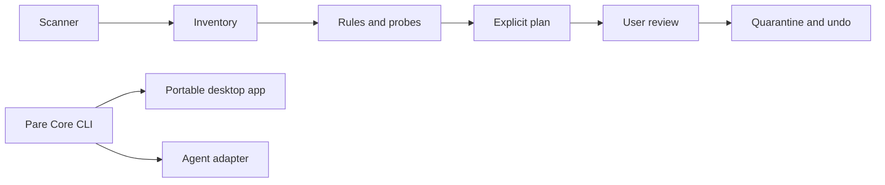

# Pare

**Windows 磁盘清理，先看证据，再决定动作。**

Pare 是 DRAG0NM 的个人项目，目标是把磁盘占用分析、清理规则和可恢复执行放进同一条可审计流程。项目目前处于设计阶段，尚未提供可运行版本；本文描述目标，不代表功能已经实现。

## 设计目标

- 在本地 NTFS 卷上枚举文件和目录，并说明访问受限、文件变化等覆盖缺口。
- 为每个清理候选保存规则命中和验证证据；未知或冲突时保留文件。
- 先生成明确计划，经用户确认后隔离文件；提供带冲突检查的撤回流程。
- 让命令行核心独立于桌面界面，供便携版和 Agent 插件复用。
- 以真实扫描和恢复测试决定性能与支持范围，不预先承诺速度或清理收益。

## 系统结构

`pare-core` 是产品核心和接口边界。首个扫描后端使用 Windows 目录枚举 API；NTFS MFT 作为可选后端，只有在原型基准、正确性对拍和依赖审查通过后才进入实现。具体决策见 [设计与安全模型](docs/design.md)。

## 安全边界

- 扫描结果只描述观察到的状态，不构成删除授权。
- 执行前重新核对卷、文件身份、父目录链、规则版本和文件状态。
- 隔离与永久删除是不同动作；永久清空需单独确认。
- 规则负责决策。语言模型不选择文件、不放宽保护规则，也不直接调用文件系统写操作。
- Agent 接口默认只读；宿主无法提供可验证审批时，写入能力保持关闭。

风险分级、失败处理和回滚边界见 [设计稿](docs/design.md)。

## 开发状态

| 阶段 | 状态 |
|---|---|
| 架构与安全约束 | 已整理，待实现验证 |
| 只读目录扫描 CLI | 未开始 |
| 规则与计划生成 | 未开始 |
| 隔离与撤回执行器 | 未开始 |
| 便携桌面界面 | 未开始 |
| MFT 可选扫描后端 | 需基准后决定 |

实施顺序和每阶段验收条件见 [开发计划](docs/development-plan.md)。

## 范围

首期聚焦 Windows、本地卷、文件占用分析、候选解释、计划审阅、文件隔离与撤回。不提供注册表清理、通用系统优化、静默删除、云端扫描或模型自主清理。驱动和 Windows 组件维护若要支持，必须走独立的官方维护流程，不进入通用文件清理规则。

## 开发

核心语言暂定 Go，Windows API 封装、CLI、目标 Windows 版本和打包方式会在原型阶段确认。当前仓库以设计文档为主，代码和构建命令尚未建立。

## 来源与许可

产品设计和 Pare 自有代码将由 DRAG0NM 维护。第三方实现、依赖和素材会在实际引入时按固定版本记录来源、许可与修改范围；本仓库不会把复用代码描述为原创。项目许可证尚未确定，仓库当前为私有。
